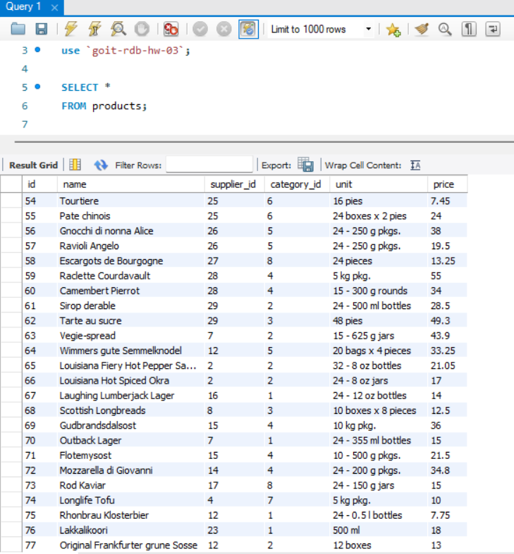
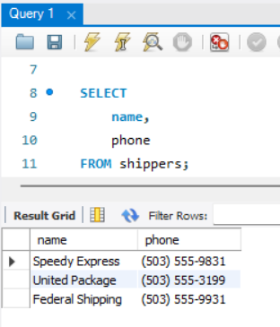
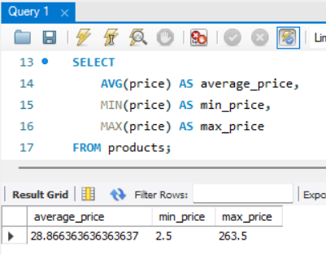
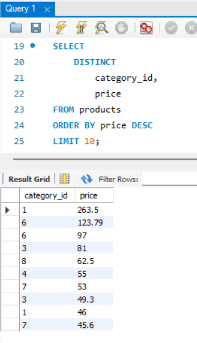
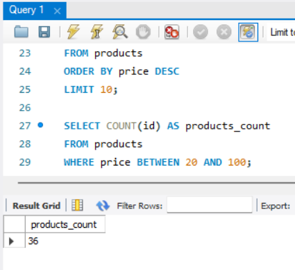
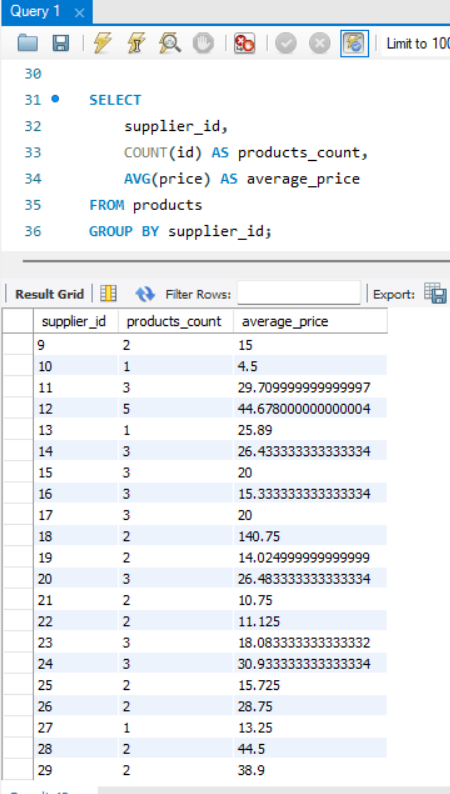

# goit-rdb-hw-03: 

Data loading and SQL basics. DQL commands

Репозиторій містить виконання практичного домашнього завдання до Теми 3: імпорт датасету, робота зі структурою реляційних даних та написання базових запитів мовою вибірки даних DQL (Data Query Language) у середовищі MySQL Workbench.

---

## Завдання 1. Базова вибірка даних (SELECT)

### 1.1. Вибірка всіх стовпчиків таблиці `products`
Використано символ wildcard (`*`) для отримання повної таблиці продуктів.

```sql
SELECT * 
FROM products;
```



### 1.2. Вибірка конкретних стовпчиків таблиці `shippers`
Отримано контактні дані перевізників (`name`, `phone`).

```sql
SELECT 
    name, 
    phone 
FROM shippers;
```



---

## Завдання 2. Агрегатні функції (AVG, MIN, MAX)

Розраховано середнє, мінімальне та максимальне значення ціни одиниці товару (`price`) з таблиці `products` з використанням інформативних псевдонімів стовпців.

```sql
SELECT 
    AVG(price) AS average_price,
    MIN(price) AS min_price,
    MAX(price) AS max_price
FROM products;
```



---

## Завдання 3. Фільтрація дублікатів, сортування та лімітування (DISTINCT, ORDER BY, LIMIT)

Отримано 10 унікальних комбінацій значень `category_id` та `price` із сортуванням за спаданням вартості.

```sql
SELECT DISTINCT 
    category_id, 
    price 
FROM products
ORDER BY price DESC
LIMIT 10;
```



---

## Завдання 4. Діапазонна фільтрація (BETWEEN / AND, COUNT)

Знайдено загальну кількість найменувань продуктів у ціновому діапазоні від 20 до 100 включно.

```sql
SELECT COUNT(id) AS products_count
FROM products
WHERE price BETWEEN 20 AND 100;
```



---

## Завдання 5. Групування даних (GROUP BY)

Обчислено загальну кількість продуктів і середню вартість товарів у розрізі кожного постачальника (`supplier_id`).

```sql
SELECT 
    supplier_id, 
    COUNT(id) AS products_count, 
    AVG(price) AS average_price
FROM products
GROUP BY supplier_id;
```



---

## Структура репозиторію

* `goit-rdb-hw-03.sql` — повний скрипт виконання SQL-запитів до схеми.
* `goit-rdb-hw-03.sql` — той самий скрипт в форматі txt.
* `goit-rdb-hw-03.mwb` — файл моделі бази даних MySQL Workbench.
* `csv_dataset/` — каталог із вихідними файлами датасету (.csv).
* `p1_SELECT_ALL.png` — результат виконання пункту 1.1.
* `p1_SELECT_FROM.png` — результат виконання пункту 1.2.
* `p2_AVG_MIN_MAX.png` — результат виконання пункту 2.
* `p3_DISTINCT_ORDER_LIMIT.png` — результат виконання пункту 3.
* `p4_COUNT_WHERE_AND.png` — результат виконання пункту 4.
* `p5_GROUP_BY.png` — результат виконання пункту 5.
* `README.md` — опис структури завдання та звіт виконання.
